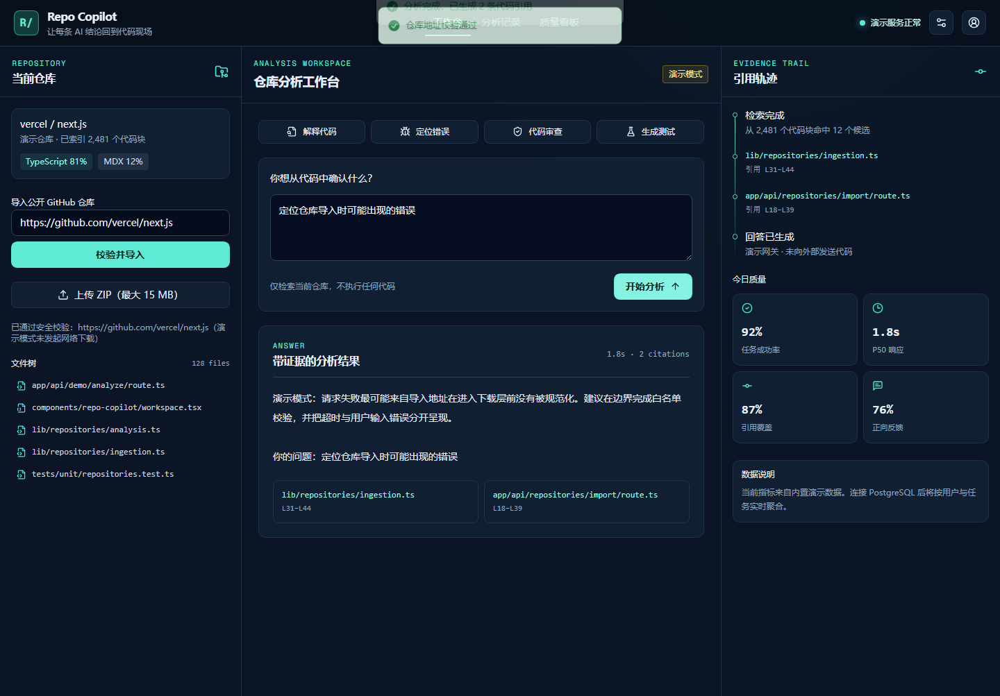

# Repo Copilot｜代码仓库 AI 助手

一个面向代码仓库的全栈 AI 分析工作台。它把“回答”与“证据”放在同一界面中，支持仓库地址安全校验、代码解释、错误定位、代码审查、测试建议、逐行引用和质量指标。

> 本项目基于 Vercel Chatbot 二次开发；上游版本、许可证和个人开发边界见 [UPSTREAM.md](UPSTREAM.md)。当前默认运行的是无需密钥和数据库的演示模式，不会下载或执行用户仓库中的代码。



## 核心能力

- 安全导入边界：仅接受规范化的公开 GitHub HTTPS 地址，拒绝凭据、查询参数和异常路径。
- 可追溯分析：解释、调试、审查、测试四类任务均返回文件路径和一基行号。
- 工程质量：纯函数单元测试、TypeScript 严格检查、静态检查、生产构建和 Playwright 浏览器验收。
- 可扩展底座：保留 Vercel Chatbot 的 Next.js、Auth.js、AI SDK 和 PostgreSQL 能力，真实模型与持久化可按需启用。

## 本地运行

要求 Node.js 20+ 与 pnpm 10+。

```bash
pnpm install
pnpm dev
```

打开 <http://localhost:3000>。默认演示模式不需要环境变量；接入真实 AI Gateway、PostgreSQL 与对象存储时，请复制 `.env.example` 为 `.env.local` 并只填写自己的密钥，切勿提交该文件。

## 验证命令

```bash
pnpm test:unit
pnpm check
pnpm exec tsc --noEmit
pnpm build
```

## 关键目录

- `components/repo-copilot/`：三栏分析工作台
- `lib/repositories/`：导入安全边界、代码分块、演示分析与指标
- `app/api/demo/analyze/`：带输入限制的演示 API
- `tests/unit/`：仓库 URL、忽略规则、分块和质量指标测试
- `docs/superpowers/specs/`：设计说明与实现计划

## 项目边界

演示数据和质量指标均有明确标识，不冒充线上真实数据。真实仓库抓取还需要服务端下载配额、禁用跨域重定向、内容大小限制、恶意文件扫描与异步索引队列。

---

## English

Repo Copilot is a repository-aware AI analysis workspace built on top of Vercel Chatbot. It demonstrates secure GitHub URL validation, code-oriented tasks, line-level citations, quality metrics, responsive UI, and a safe offline demo mode.

Run `pnpm install && pnpm dev`, then open <http://localhost:3000>. See [UPSTREAM.md](UPSTREAM.md) for attribution and the exact upstream revision. The demo never downloads or executes repository code.
